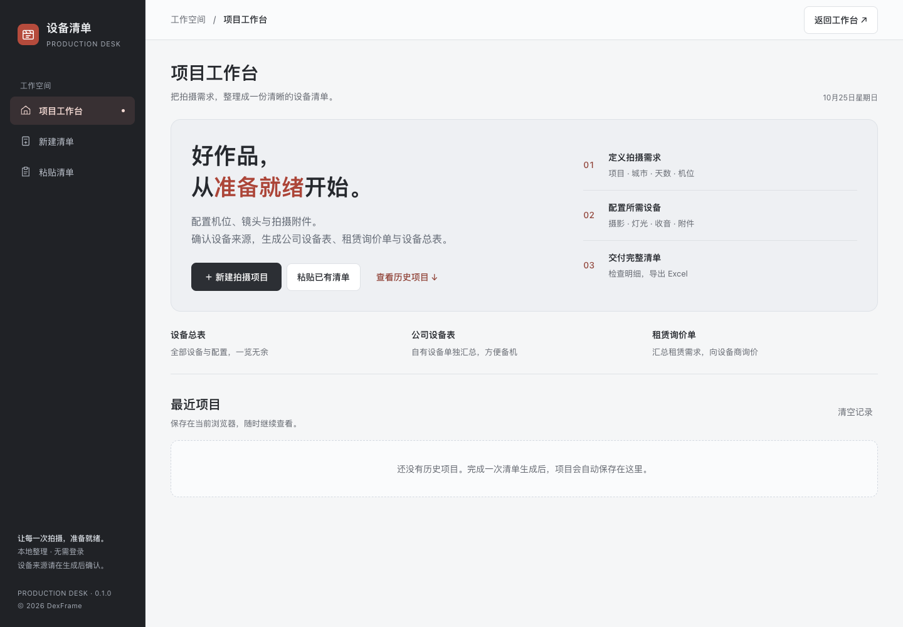

# 设备清单生成器 · Production Desk

把拍摄需求整理成可以交付的设备清单。向导配置或粘贴文字，生成设备总表、公司设备表与租赁询价单，并导出 Excel。

**作者：DexFrame** · 单文件网页 · 无需账号 · 无需后端

[下载最新版](https://github.com/hademenhusky/equipment-list-generator/releases/latest) · [提交问题](https://github.com/hademenhusky/equipment-list-generator/issues)



## 开始使用

下载并解压项目，用现代浏览器打开 `index.html` 即可。不需要安装 Python、Node.js 或飞书。

1. 选择「新建拍摄项目」，逐步配置相机、镜头、灯光、收音和附件；也可选择「粘贴已有清单」。
2. 核对设备名称、数量与配置。识别模式只要求处理存疑项，支持手动修改。
3. 生成表格后设置设备来源：批量选择「公司」或「租赁」，也可进入编辑模式逐项调整。
4. 点击「导出全部」，得到包含三张工作表的 `.xlsx` 文件。

未指定来源的设备显示「待确认」，只进入总表。没有报价的租赁设备显示「待询价」，金额汇总仅包含已知价格。

## 可以做什么

- 11 步向导，配置多机位、镜头、灯光、收音、图传及其他拍摄附件。
- 自定义镜头和灯具；调整灯光、收音的数量。
- 本地识别设备简称、中文数量、常见乘号、多行备注及镜头组合。
- 保留不明确的型号与规格，提示人工核对，不凭空补价格。
- 编辑、增删设备，分别查看总表、自有设备和租赁需求。
- 保存最近 20 个项目到当前浏览器；完成编辑或导出时更新历史。
- 支持手机和桌面布局，Excel 带有分组、列宽与样式。

## 数据与使用边界

- 文字识别、编辑和历史处理都在浏览器本地进行，不调用 AI 或飞书，不上传清单内容。
- Excel 库 `xlsx-js-style@1.2.0` 从 jsDelivr 加载，因此**首次打开并导出需要网络**。页面加载后可断网识别与导出；全新浏览器离线首开时，导出库可能不可用。CDN 会收到普通脚本加载请求，不包含清单文本。
- 浏览器历史不是备份，也不跨设备同步。清理浏览器数据、切换浏览器或移动本地文件可能无法访问原历史，请导出保存重要项目。
- 不包含设备库存、出入库、登录、飞书同步、真实供应商或报价。所有向导设备默认来源待确认；粘贴文字明确写了「公司」或「租赁」时保留该标记。
- 向导含便于快速开始的设备组合，例如索尼大三元、默认收音和附件；请在生成后按实际拍摄需要编辑。
- 每次文字导入最多 20,000 字符、300 项设备；不支持图片 OCR。

## 识别约定

这些是工具的默认规则，生成后仍可修改：

- 裸写 `x3` 默认索尼 FX3；明确写影石 X3 时保留对应品牌。
- `RS4 / 如影4` 默认 RS4 Pro；明确写标准版或 Mini 时优先采用原文。
- 没有品牌上下文的 `16-35 / 24-70 / 70-200` 默认索尼 GM 二代；仅有佳能机身时按佳能处理，明确写出的品牌或代际优先。
- `大三元` 展开为三颗镜头；`360套装` 默认 Insta360 X5。
- `卡3张2561张80` 约定为 256G A 卡 3 张、80G A 卡 1 张；其他不明确的数字串不会套用这条规则。

## 自定义设备与参考价

在 `index.html` 中维护 `CAMERA_OPTIONS`、`LENS_OPTIONS`、`LIGHT_EQUIPMENT`、`AUDIO_OPTIONS`、`DRONE_OPTIONS` 等目录。目录表示可选型号，不代表库存。

`PRICE_DB` 默认是空的。需要内部参考价时，可在自己的副本中添加精确名称对应的数据。例如下面是**虚构演示数据**：

```js
const PRICE_DB = {
  vendors: [{
    name: '示例供应商', brand: '演示', contact: '',
    items: [{ name: '索尼FX3', unit_price: 25, pricing_type: '天' }]
  }]
};
```

`name` 应与设备的 `priceKey` 一致。按天计价为单价 × 数量 × 拍摄天数；`次` 为单价 × 数量。只填写确切型号的价格，不用相似型号替代。更新配置后重新生成项目，已保存历史不会自动重算。不要把私人电话或实际报价提交到公开仓库。

## 本地开发与检查

应用无构建步骤。开发检查使用 Node.js 22 或更新版本，且不需要安装 npm 依赖：

```bash
node scripts/check.cjs
```

检查包含文件白名单、隐私边界、内联 JavaScript 语法和全部 Node 回归。单独运行测试：

```bash
node --test tests/*.test.cjs
```

价格匹配测试使用 `tests/fixtures/prices.cjs` 的人工合成值，不包含实际报价。浏览器验收记录见 [验证说明](docs/verification.md)。

## GitHub Pages

把本目录内容放在仓库根目录。推送后，在仓库 **Settings → Pages** 选择 **Deploy from a branch**，分支选择实际主分支，目录选择 **/(root)**，保存后等待部署。项目提供 `index.html` 和 `.nojekyll`，无需构建配置。参见 [GitHub 官方发布说明](https://docs.github.com/en/pages/getting-started-with-github-pages/configuring-a-publishing-source-for-your-github-pages-site)。

也可把本目录托管到任意静态网站服务。不要将包含内部服务器与原始资料的父目录一起上传。

## 贡献与许可

欢迎提交问题和改进，见 [贡献指南](CONTRIBUTING.md)。第三方导出库说明见 [THIRD_PARTY_NOTICES.md](THIRD_PARTY_NOTICES.md)。

采用 [MIT 许可证](LICENSE)。Copyright © 2026 DexFrame。
